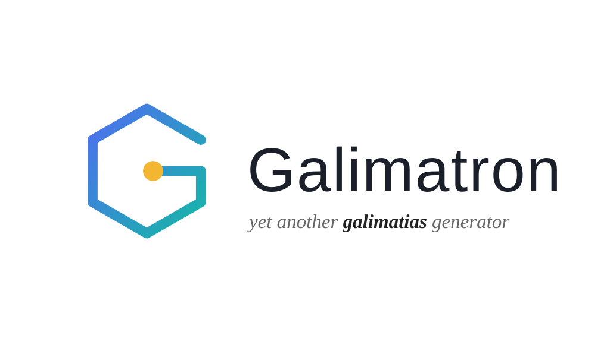
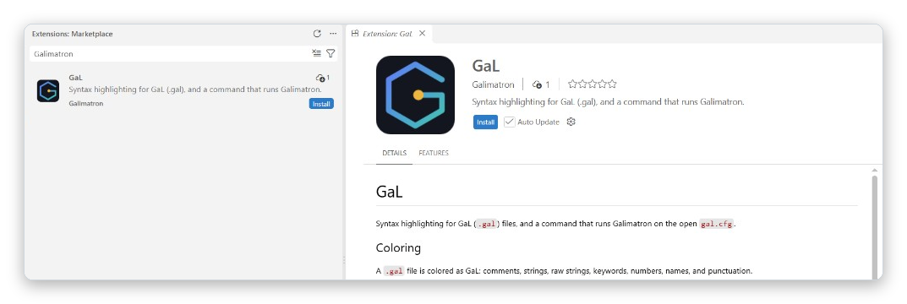

<p align="center">
  
</p>

# Galimatron

Galimatron is a command line tool that keeps **one versioned description of your data** and lets you generate everything else from it.

You describe your data once, in text files called **GaL** files (Galimatron Language, `.gal`). Galimatron checks the description, edits it on your command, and compiles it into **XML**. From that XML you make whatever you need: source code in the language of your choice, documentation, database schemas, test data, a web page.

## Key features

- **A very simple language, and the state is only text.** A GaL file looks like JSON: aggregates with versions, and tags with values. All the state of a project is in `.gal` files: no binaries, no database, no hidden project files. They live in git like any other text. [More](https://goloveshin.github.io/galimatron_doc/entities/)
- **The history lives inside the data.** Every `.gal` file holds all versions of a description, so a generator sees version 2 next to version 3, not only today's state. [More](https://goloveshin.github.io/galimatron_doc/aggregates-and-versions/)
- **A closed version cannot change by accident.** A hash seals a version. A changed value is an error, and your XSLT cannot rewrite a sealed version: the seal moves the change into the first open one. [More](https://goloveshin.github.io/galimatron_doc/hashes/)
- **The Wizard edits the description for you.** One command creates a version, a tag, an aggregate or a hash, and a batch of commands does many at once. You do not copy and edit many files by hand. The result is written back into the `.gal` files, so the project **modifies itself** and the next run starts from it. [More](https://goloveshin.github.io/galimatron_doc/wizard/)
- **The primary output is XML.** Every run writes the compiled description, with the history of every version, as an ordinary XML file (`post-compiled.xml`). Running XSLT inside Galimatron is optional: Saxon, an XSLT processor, is built in and it is the convenient way, but you may read the XML with any tool, or none. [More](https://goloveshin.github.io/galimatron_doc/how-it-works/#the-primary-output-is-xml)
- **It is not tied to any language.** No programming language, data format or database is built into Galimatron. You can generate anything you like. What is generated is decided by what reads the XML. [More](https://goloveshin.github.io/galimatron_doc/how-it-works/#not-tied-to-any-language)
- **Declare once, inherit everywhere.** Tags written in the root flow into every aggregate. Labels name the values and give your XSLT something to read by name. [More](https://goloveshin.github.io/galimatron_doc/entities/)
- **Values that must be new in every version.** A dynamic label asks your XSLT for the next id or counter, and a custom state remembers what your XSLT needs between runs. [More](https://goloveshin.github.io/galimatron_doc/labels/)
- **Checked before it is written.** The run parses and validates the description, and checks the seal, before your `.gal` files are rewritten. A failing check stops the run there. [More](https://goloveshin.github.io/galimatron_doc/how-it-works/#the-steps)
- **Deterministic.** The same `.gal` files and the same XSLT give the same result, so a run that has nothing to change leaves no diff in version control. [More](https://goloveshin.github.io/galimatron_doc/how-it-works/#a-run-is-deterministic)
- **Easy to see what happened.** A log with the time and memory of every step, a summary, and XML dumps of every stage. [More](https://goloveshin.github.io/galimatron_doc/diagnostics/)
- **Measured.** Up to 500 aggregates and 100 versions, with the numbers published. [More](https://goloveshin.github.io/galimatron_doc/benchmark/)
- **One tool, no library.** Galimatron is one executable for Windows and Linux. You do not link it into your program. You run it, and it reads and writes the folders that you name in `gal.cfg`. There is an extension for Visual Studio Code. [More](https://goloveshin.github.io/galimatron_doc/getting-started/)

## Documentation

<https://goloveshin.github.io/galimatron_doc/>

It explains how to install Galimatron, the language (aggregates, versions, tags, labels, ordering), the Wizard that edits `.gal` files for you, hashes and closed versions, `gal.cfg` and `log.cfg`, XSLT, templates, and custom states. Two worked examples are included: messages that grow through thirteen versions, and a benchmark.

## Install

Download an installer from the [Releases](https://github.com/goloveshin/galimatron/releases) page, or build one yourself (below).

| System | Packages |
|---|---|
| Windows | an NSIS setup (`galimatron-*.exe`) and a zip |
| Linux | `tar.gz`, `deb` and `rpm` |

For Visual Studio Code there is the **GaL** extension. It colors `.gal` files and runs Galimatron on the open `gal.cfg`. Search for `Galimatron` in the Extensions view.

<p align="center">
  
</p>

## Build

You need:

- CMake 4.0 or newer
- a C++23 compiler: MSVC 19.5 or newer, GCC 13 or newer, or Clang 18 or newer
- Java, for the ANTLR parser generator
- Git and a network, because the dependencies are fetched by CMake's `FetchContent`

```
cmake -S . -B build -G Ninja -DCMAKE_BUILD_TYPE=Release
cmake --build build --config Release
cmake --build build --config Release --target run_tests
cmake --build build --config Release --target package
```

The CI in `.github/workflows` runs the same steps on Windows (MSVC) and Linux (GCC and Clang), in Debug and Release.

## Run

In a project folder with `gal.cfg` and `log.cfg`:

```
galimatron --gal-config-file gal.cfg --log-config-file log.cfg
```

## What is in the repository

| Folder | What it holds |
|---|---|
| `galimatron/` | the tool: the language, the translator, the runtime, the executable, the tests |
| `global/` | shared code used by the tool |
| `examples/uuid_protocol/` | messages that grow, described in GaL, in thirteen steps |
| `examples/benchmark/` | a generated project that measures time and memory |
| `externals/` | SaxonC-HE and the base64 library |
| `cmake/` | dependencies, tests runner, packaging |
| `art/` | the logo and the banner, and the logos of the libraries (`art/third_party/`) |
| `third_party_licenses/` | the license texts of the libraries |

## Built with

[Boost](https://www.boost.org) · [ANTLR 4](https://www.antlr.org) · [SaxonC-HE](https://www.saxonica.com) · [Taskflow](https://github.com/taskflow/taskflow) · [range-v3](https://github.com/ericniebler/range-v3) · [pugixml](https://pugixml.org) · [nlohmann/json](https://github.com/nlohmann/json) · [inja](https://github.com/pantor/inja) · [alpaca](https://github.com/p-ranav/alpaca) · [magic_enum](https://github.com/Neargye/magic_enum) · [doctest](https://github.com/doctest/doctest) · [logme](https://github.com/efmsoft/logme) · [JsonCpp](https://github.com/open-source-parsers/jsoncpp) · [leaf_spy](https://github.com/goloveshin/leaf_spy) · [multi_index_lookup](https://github.com/goloveshin/multi_index_lookup)

What each one is used for, and its license, is in [THIRD_PARTY_NOTICES.md](THIRD_PARTY_NOTICES.md).

## License

Distributed under the Boost Software License, Version 1.0. See [LICENSE](LICENSE).

The libraries are under the Boost, MIT, BSD-3-Clause and Apache-2.0 licenses, and SaxonC-HE under MPL-2.0. All of them are permissive and none requires Galimatron itself to change its license. Their notices travel with the installers.
